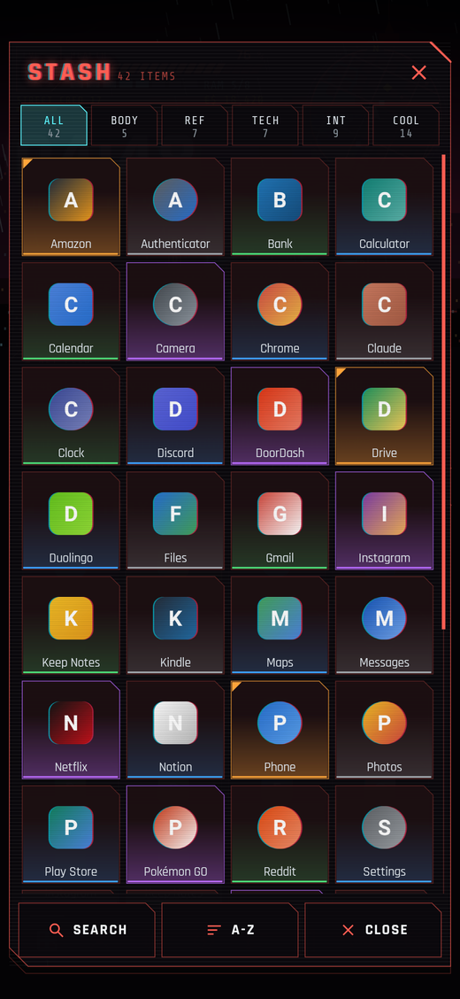
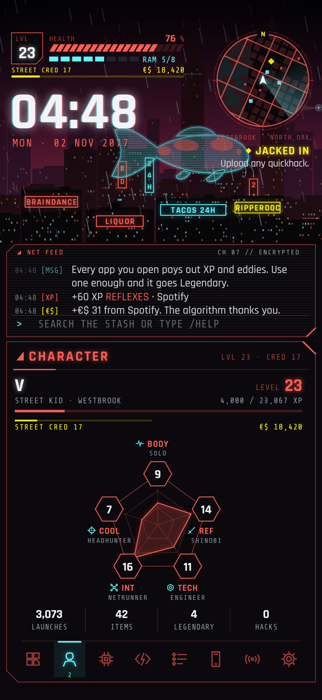
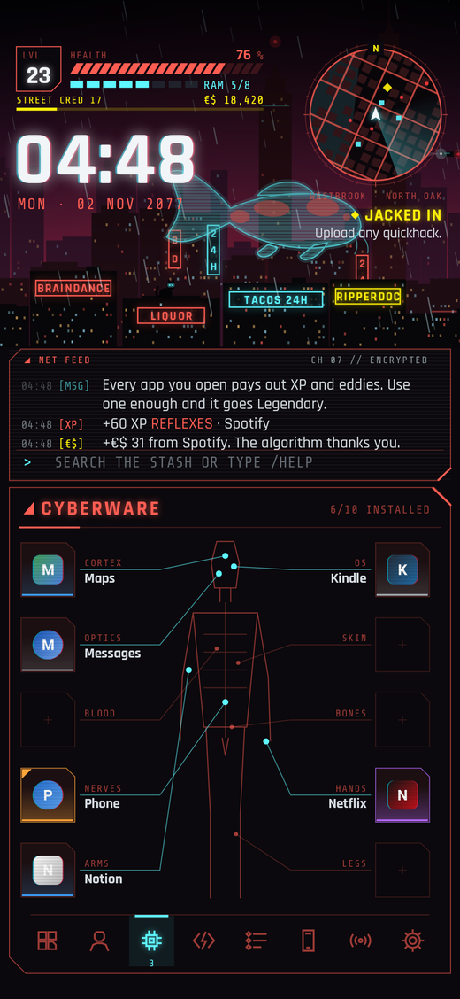
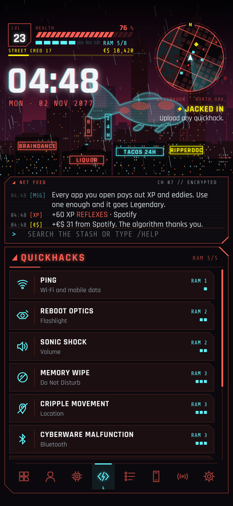
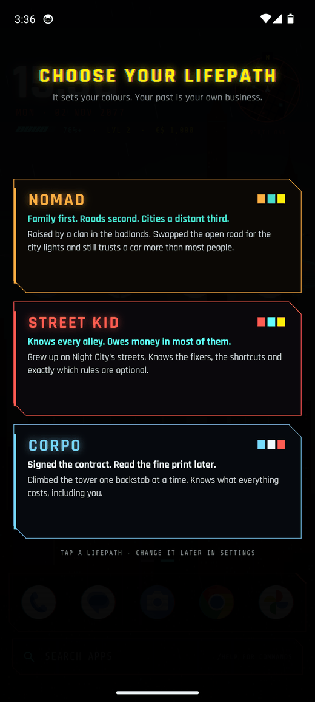
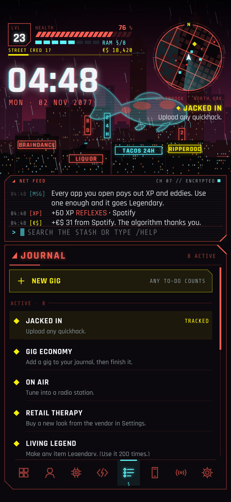
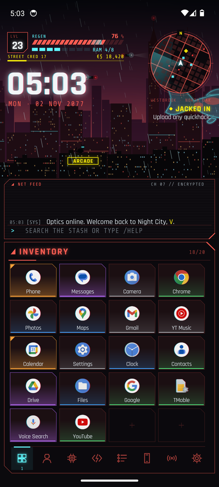

# CyberLauncher

An Android home screen launcher that thinks it's a Cyberpunk 2077 HUD.
Your battery is your health bar. Your apps are loot. Opening Instagram too often gets the NCPD involved.

  
  
  

  
  
  

  
  
  

The last one is a real Pixel 6 emulator in CI, with real apps. The rest are previews rendered off-device with stand-in icons.

  

## Install

1. On your phone, download **[CyberLauncher.apk](https://github.com/RamonG3/Misc./releases/download/cyberlauncher-latest/CyberLauncher.apk)**
   (GitHub Actions rebuilds it on every push).
2. Open it and allow installing from your browser if Android asks.
3. Press Home and pick **CyberLauncher**, or go to Settings → Apps → Default apps → Home app.
4. Choose your lifepath. It only picks your colours, so don't overthink it.

To go back: Settings tab → *Quit game*. It opens the home app picker, which is as close as
a launcher gets to a quit button.

## What does what

| Night City | On your phone |
|---|---|
| Health bar | Battery. Says REGEN on the charger. Below 15% it flashes CRITICAL and the city gets a red vignette. Tap for battery settings. |
| RAM | Free memory, one cell per eighth. Quickhacks spend it and it recovers. Tap for quickhacks. |
| Level, Street Cred | Every launch pays XP and Street Cred. Finished jobs pay more. Level 60 takes about two years of normal phone use, which you were going to do anyway. |
| Eddies (€$) | Earned on every launch. Spend them at the vendor in Settings on new colour schemes. |
| Minimap | Your maps app. Hold it to fast travel to another district (new map, new skyline). |
| Tracked job | Whatever you're tracking in the journal. Tap to open the journal. |
| Clock / date | Alarms / calendar. The year is Night City time (+51) unless you switch it to boring. |
| Inventory (20 slots) | Favourite apps. Tap to open, hold for the menu, hold and drag to rearrange. Tap an empty slot to fill it. |
| Item rarity | Earned by use: Common, Uncommon (5 launches), Rare (25), Epic (75), Legendary (200). Your single most-used app goes Iconic at 400. |
| Stash | Every app. Swipe up anywhere, or tap the net feed to search. Filter by attribute; sort by name, rarity or most recent. |
| Net feed | Everything the launcher has to say. Tap it to search; Enter opens the top match. `/help` lists commands. |
| Scanner | Hold an item → Scan. Shows which sensitive permissions the app actually holds (location, microphone, camera, contacts...), a threat level, version and install dates, and a bounty that means nothing. |
| Character | The five attributes on a pentagon. Each app trains one: Body (fitness, food, maps), Reflexes (games, video, music), Technical Ability (tools, camera, settings), Intelligence (browsers, AI, docs, email), Cool (social, messaging, shopping, money). Tap one to see its apps. |
| Cyberware | Ten more favourite slots, wired into a ripperdoc's diagram. |
| Quickhacks | Quick settings. Ping is Wi-Fi, Reboot Optics the flashlight, Sonic Shock volume, Memory Wipe Do Not Disturb, Cripple Movement location, Cyberware Malfunction Bluetooth, Overheat battery saver, Request Backup hotspot, System Reset airplane mode, Breach Protocol everything else. |
| Journal | A to-do list. Main jobs teach you the launcher; gigs are your own. Tap a gig when it's done and the fixer pays. |
| Phone | One tap for calls, texts, camera ("photo mode"), the net and maps, plus your recent apps as contacts. |
| Radio | Play, pause and skip for whatever is playing, dressed as a car radio. Stations unlock as you level. They are all fictional. So is the music, as far as your phone knows. |
| NCPD heat | Open enough apps in 15 minutes and the stars come out. They leave when you put the phone down. Unlike you. |
| Lifepath | Nomad, Street Kid or Corpo, picked on first run. Sets your colours. Change it in Settings. |
| Swipes | Down for notifications. Sideways on the panel to flip tabs. |

The city is drawn live: rain, flying cars, flickering neon, tower beacons and a holographic koi.
It only animates while the home screen is in front, and stops entirely in battery saver.
Rain and glitch effects can be switched off in Settings, as can the boot sequence.

There is a 1 in 1,000 chance per launch that a stray cat moves onto your roof. It will not do anything useful.

## Commands

Type these into the net feed: `/help`, `/stash`, `/scan <app>`, `/net <search>`, `/name <handle>`,
`/theme <palette>`, `/stats`, `/heat`, `/eddies`, `/travel`, `/rain`, `/glitch`, `/breach`, `/home`,
`/wallpaper`, `/settings`, `/reset`. A few others exist. `/sudo` does not work, which is the point.

## Fonts

It ships with [Rajdhani](https://github.com/google/fonts/tree/main/ofl/rajdhani) (Indian Type Foundry) and
[Share Tech Mono](https://github.com/google/fonts/tree/main/ofl/sharetechmono) (Carrois Type Design),
both SIL OFL. Licences are in `app/src/main/assets/fonts`.

## Building

Standard Android project, no third-party dependencies beyond the Kotlin standard library.
Open `CyberLauncher/` in Android Studio, or run `./gradlew assembleRelease`.

Builds are signed with `keystore/shared.jks`, a throwaway key committed on purpose so every CI
build installs over the previous one. It is fine for sideloading; don't use it for the Play Store.

CI also boots an emulator, runs the release build as the home app to check it survives, and
attaches screenshots to the release. Debug builds take `--es demo <screen>` extras
(`seed`, `stash`, `tab:N`, `scan:N`, `menu:N`, `levelup`, `theme:<id>`) so the screenshots don't
depend on tapping coordinates. Release builds ignore them.

## Disclaimer

A fan project, not affiliated with or endorsed by CD PROJEKT RED. Cyberpunk 2077 is a trademark of
CD PROJEKT S.A. No game assets are included: the city, the icons and every effect are drawn in code
(`ui/City.kt`, `ui/Glyphs.kt`), and the fonts are open source.
