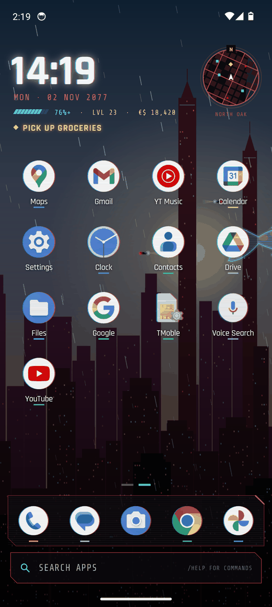
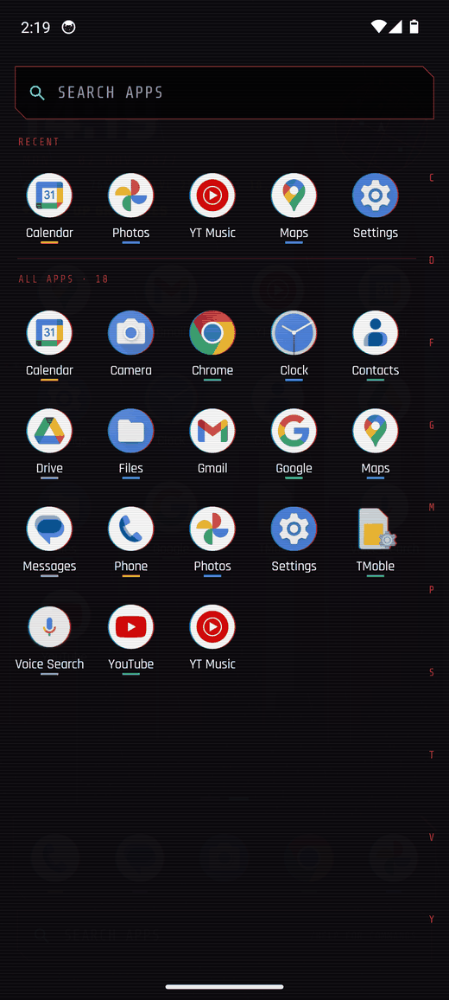
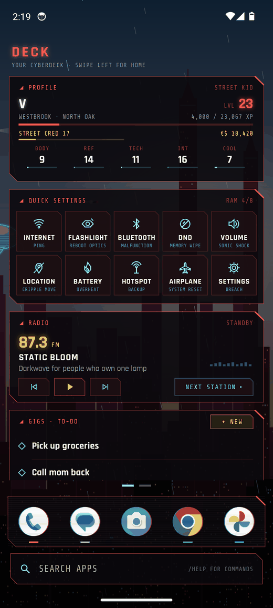
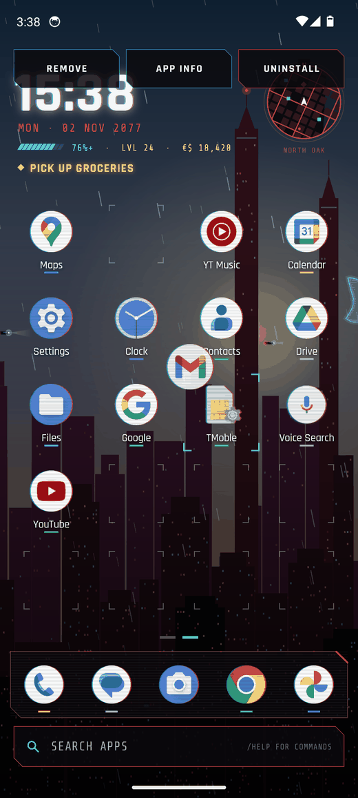
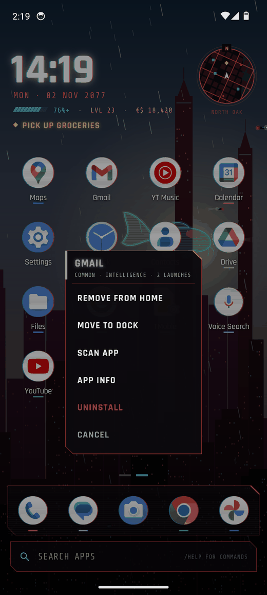
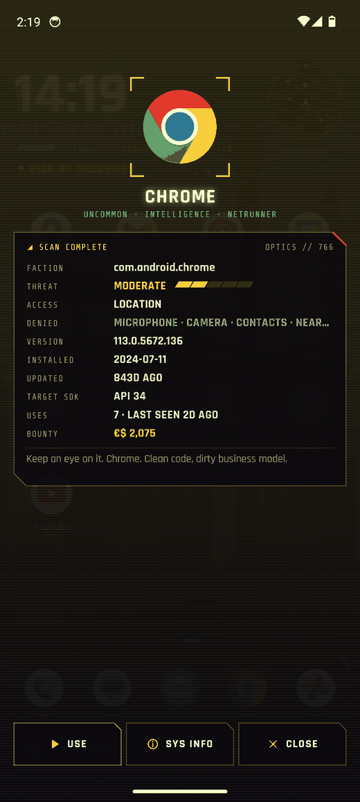
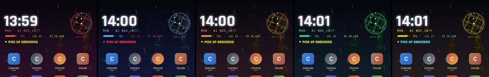

# CyberLauncher

An Android home screen with a Cyberpunk 2077 coat of paint. It works like the launcher you
already know (app grid, dock, swipe up for all apps) and looks like you just jacked in.
Night City lives behind your icons. Your battery is a health bar. Your apps level up.

  
  
  

  
  
  

  

## Install

1. On your phone, download **[CyberLauncher.apk](https://github.com/RamonG3/Misc./releases/download/cyberlauncher-latest/CyberLauncher.apk)**
   (GitHub Actions rebuilds it on every push).
2. Open it and allow installing from your browser if Android asks.
3. Press Home and pick **CyberLauncher**, or go to Settings → Apps → Default apps → Home app.
4. Choose your lifepath. It only picks your colours, so don't overthink it.

Updating from the first version keeps your apps: the old inventory becomes the home screen and
the first five cyberware slots become the dock.

## How it works

It's a normal launcher, so the usual moves do the usual things:

| Do this | Get this |
|---|---|
| Tap an app | Open it. |
| Swipe up anywhere, or tap the search bar | All apps, A to Z. Scrub the letter rail to jump. Search filters as you type; Enter opens the top match, or searches the web if nothing matches. |
| Hold an app | Options: remove from home, move to dock, scan app, app info, uninstall. |
| Hold and drag an app | Move it around the grid or into the dock. Drop it on Remove, App info or Uninstall at the top. In the app drawer, hold an app and drag it out to put it on the home screen. |
| Hold an empty spot | Add apps, launcher settings, rain on or off, a new skyline, Android settings. |
| Swipe down | Notifications. |
| Swipe right | The deck page (below). |
| Back or Home | Close whatever is open; Home again goes back to the home page. |

Up top there's a clock widget. Tap the time for alarms, the date for your calendar, the little
health bar for battery settings. The line underneath shows your level and eddies, and your next to-do if
you have one. The mini map in the corner opens your maps app; hold it for a new skyline.

## The Cyberpunk bits

- **Night City** is drawn live behind your icons: rain, flying cars, flickering neon, tower beacons
  and a holographic koi. The sky follows the real time of day. It only animates while the home
  screen is showing, and stops in battery saver. Prefer your own wallpaper? Settings → Background.
- **Battery is your health bar.** Below 15% it flashes and the edges of the screen pulse red.
- **Apps earn rarity by use.** A coloured bar under the label: Uncommon at 5 launches, Rare at 25, Epic
  at 75, Legendary at 200. Your single most-used app goes Iconic at 400. Turn it off in settings if
  you'd rather not be judged.
- **Every launch pays out** XP, Street Cred and eddies. Level 60 takes about two years of normal phone
  use, which you were going to do anyway. Eddies buy new themes in Settings.
- **Scan app** shows which sensitive permissions an app actually holds (location, microphone, camera,
  contacts...) with a threat level, plus versions and install dates.
- **NCPD heat:** open enough apps in 15 minutes and stars show up next to your level. They go
  away when you put the phone down. Unlike you.
- **Lifepath, boot sequence, glitches.** All skippable or switchable in settings.

## The deck page

Swipe right from home. Everything here has a plain label, with the 2077 name in small print:

| Card | What it does |
|---|---|
| Profile | Handle, level, Street Cred, eddies and the five attributes (Body, Reflexes, Tech, Int, Cool). Each app trains one of them, from fitness to social. |
| Quick settings | Internet, flashlight, Bluetooth, Do Not Disturb, volume, location, battery saver, hotspot, airplane mode, Android settings. (Ping, Reboot Optics, Malfunction, Memory Wipe and friends.) |
| Radio | Play, pause and skip whatever is playing. The stations are fictional and unlock as you level. |
| Gigs | A to-do list. Tap to tick one off and a fixer pays you. Hold to rename or delete. |
| Recent | Your last five apps. |

Turn the deck off in Settings if you just want the home screen.

## Commands

Type these in the app search: `/help`, `/scan <app>`, `/net <search>`, `/name <handle>`, `/theme <name>`,
`/stats`, `/heat`, `/eddies`, `/travel`, `/rain`, `/glitch`, `/breach`, `/settings`, `/reset`. A few others
exist. `/sudo` does not work, which is the point.

There is a 1 in 1,000 chance per launch that a stray cat moves onto your roof. It will not do anything useful.

## Fonts

It ships with [Rajdhani](https://github.com/google/fonts/tree/main/ofl/rajdhani) (Indian Type Foundry) and
[Share Tech Mono](https://github.com/google/fonts/tree/main/ofl/sharetechmono) (Carrois Type Design),
both SIL OFL. Licences are in `app/src/main/assets/fonts`.

## Building

Standard Android project, no third-party dependencies beyond the Kotlin standard library.
Open `CyberLauncher/` in Android Studio, or run `./gradlew assembleRelease`.

Builds are signed with `keystore/shared.jks`, a throwaway key committed on purpose so every CI
build installs over the previous one. It is fine for sideloading; don't use it for the Play Store.

CI also boots an emulator, runs the release build as the home app to check it survives real
taps and swipes, and attaches screenshots to the release (the ones above come from there). Debug
builds take `--es demo <screen>` extras (`seed`, `home`, `drawer`, `deck`, `settings`, `scan:N`,
`menu:N`, `homemenu`, `levelup`, `theme:<id>`) so most screenshots don't depend on tapping
coordinates, and log what the home screen did with each touch under the `CyberTouch` tag.
Release builds ignore both.

## Disclaimer

A fan project, not affiliated with or endorsed by CD PROJEKT RED. Cyberpunk 2077 is a trademark of
CD PROJEKT S.A. No game assets are included: the city, the icons and every effect are drawn in code
(`ui/City.kt`, `ui/Glyphs.kt`), and the fonts are open source.
