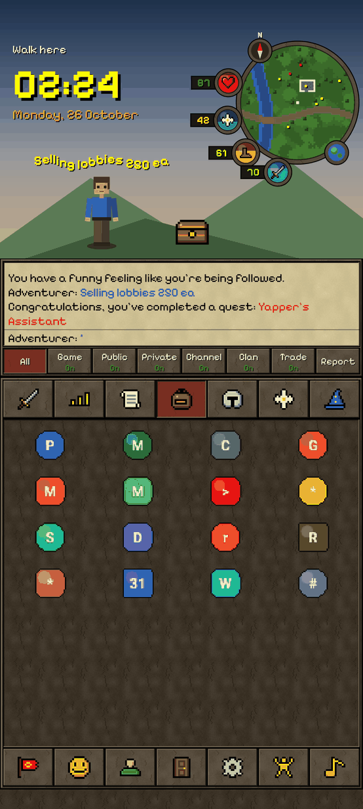
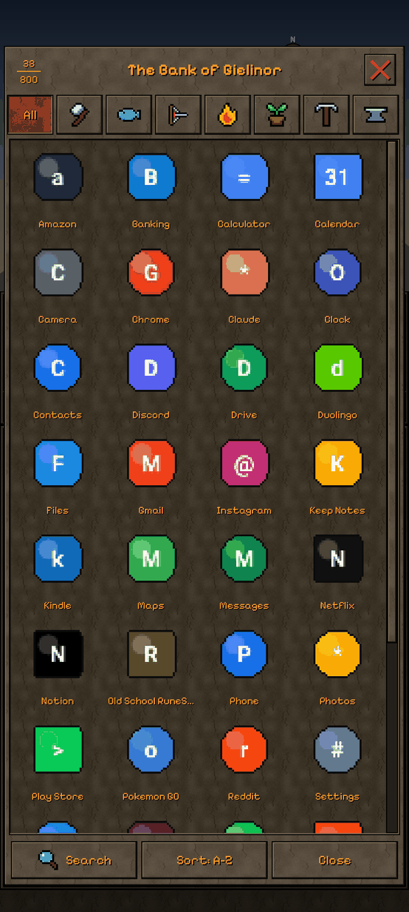
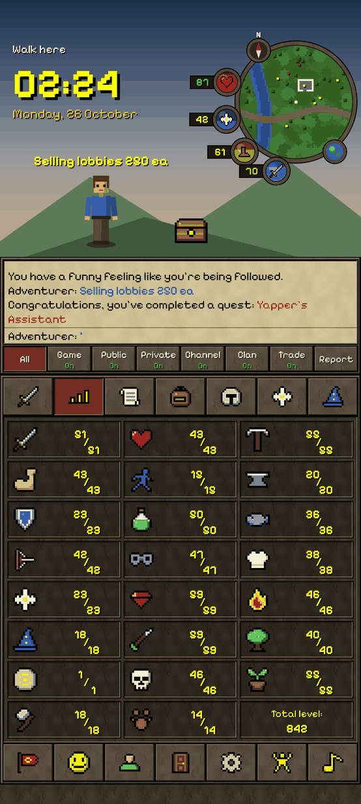
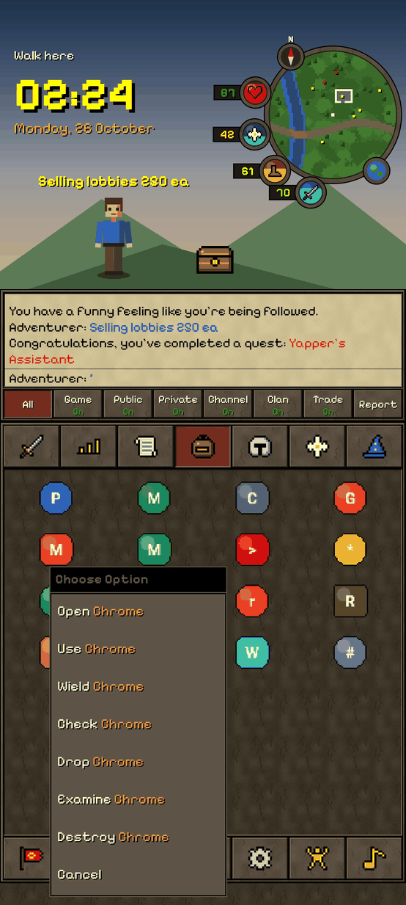
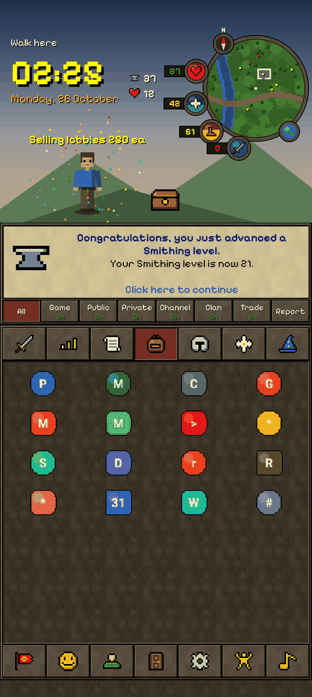
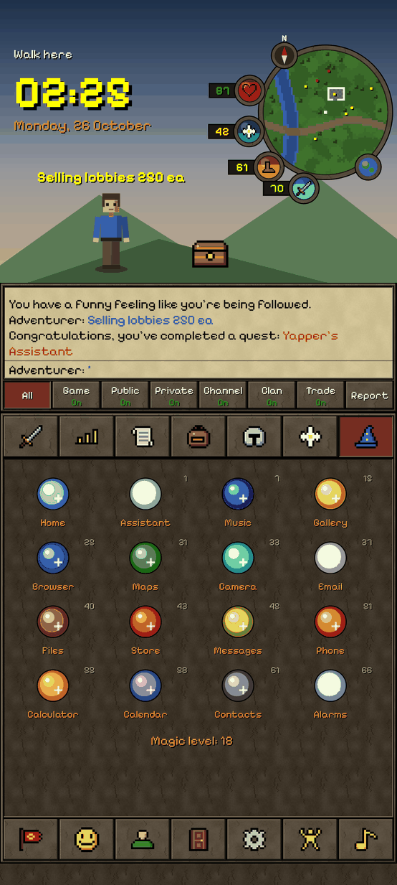

# RuneLauncher

An Android home screen launcher that thinks it's Old School RuneScape.
Your apps are inventory items. Your app drawer is a bank. Opening Spotify trains Prayer.

  
  
  

  
  
  

## Install

1. On your phone, download **[RuneLauncher.apk](https://github.com/RamonG3/Misc./releases/download/runelauncher-latest/RuneLauncher.apk)**
   (GitHub Actions rebuilds it on every push).
2. Open it and allow installing from your browser if Android asks.
3. Press Home and pick **RuneLauncher**, or go to Settings → Apps → Default apps → Home app.

To go back: Logout tab → *Click here to logout*. It opens the home app picker, which is the
closest thing to logging out of a launcher.

## What does what

| RuneScape | On your phone |
|---|---|
| Inventory (28 slots) | Favourite apps. Tap to open, hold for the menu, hold and drag to rearrange. |
| Bank of Gielinor | Every app. Swipe up, or tap the bank chest. Skill tabs, search, sorting. |
| Chatbox | Tap it to search. Enter opens the first match. `::help` lists commands. Start with `/` to talk out loud. |
| "Choose Option" menu | Open, Use, Wield, Check (app info), Drop, Examine, Destroy (uninstall). |
| Skills | Every launch gives XP to a skill picked from the app (social apps train Thieving). Real XP curve. Level 99 takes years. |
| Hitpoints orb | Battery. Tap for battery settings. |
| Prayer orb | Free storage. Tap for the flashlight (quick-prayer). |
| Run orb | Free memory. Tap for the internet panel. |
| Special attack orb | Media volume. Tap for the volume slider. |
| World map orb | Your maps app. |
| Compass | World hop (new minimap). |
| Clock / date | Alarms / calendar. |
| Combat tab | Punch / Kick / Block = chunky pixels / fine pixels / HD icons. Auto Retaliate = haptics. |
| Quest list | A to-do list. Tap to go red → yellow → green. A few built-in quests teach you the launcher. |
| Worn Equipment | Wield apps for 11 more favourite slots. |
| Prayer book | Quick settings: Wi-Fi, Bluetooth, Do Not Disturb, display, location... |
| Spellbook | Default apps: Varrock Teleport is your browser, High Level Alchemy is the calculator. Casting trains Magic. |
| Clan | Your apps grouped by the skill they train. |
| Friends list | Recently used apps. "Online" if used today. |
| Emotes | 22 of them. Your adventurer performs them. |
| Music player | Play/pause/skip for whatever is playing. Tracks unlock with total level. |
| Swipe down | Notification shade. |

Overhead chat supports the classic effects: `red:wave:Selling lobbies`, `flash1:`, `glow1:`, `scroll:`, `shake:` and so on.

There is a 1 in 1,000 chance per app launch of something following you around.

## Fonts

It ships with [Pixelify Sans](https://github.com/eifetx/Pixelify-Sans) (SIL OFL, licence in
`app/src/main/assets/fonts`). If you have a fan-made RuneScape font, put it at
`app/src/main/assets/fonts/runescape.ttf` (and optionally `runescape_bold.ttf`) and rebuild.

## Building

Standard Android project, no third-party dependencies beyond the Kotlin standard library.
Open `RuneLauncher/` in Android Studio, or run `./gradlew assembleRelease`.

Builds are signed with `keystore/shared.jks`, a throwaway key committed on purpose so every CI
build installs over the previous one. It is fine for sideloading; don't use it for the Play Store.

## Disclaimer

A fan project, not affiliated with or endorsed by Jagex. RuneScape and Old School RuneScape are
trademarks of Jagex Ltd. No Jagex assets are included: every sprite is hand-drawn ASCII art in
`ui/Sprites.kt`, and the textures, minimap and character are generated in code.
