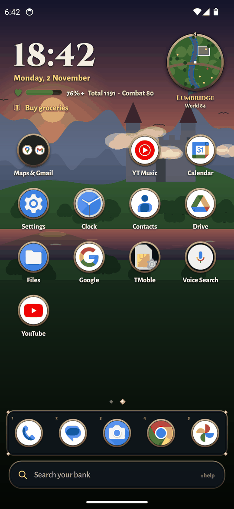
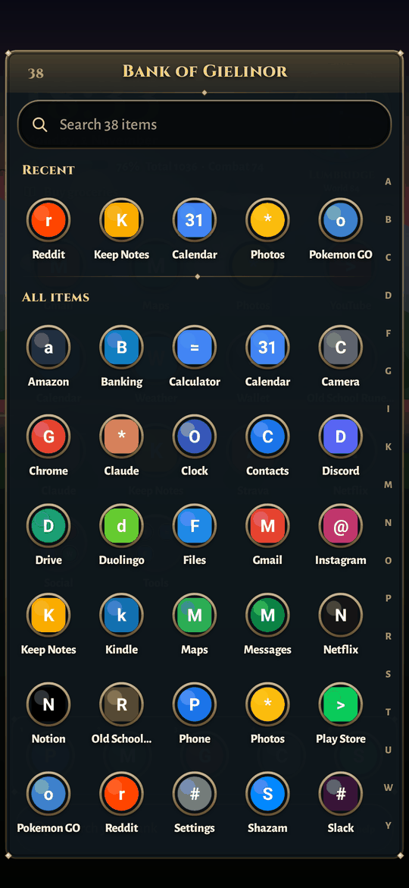
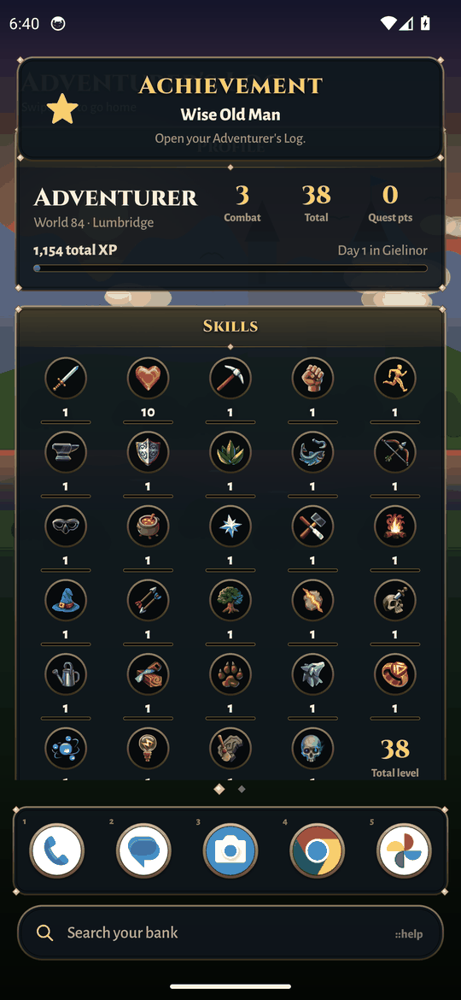
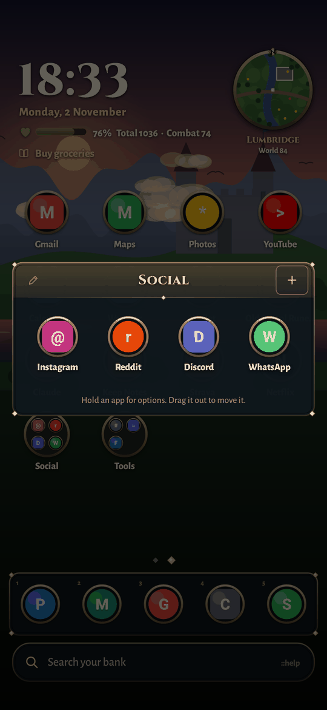
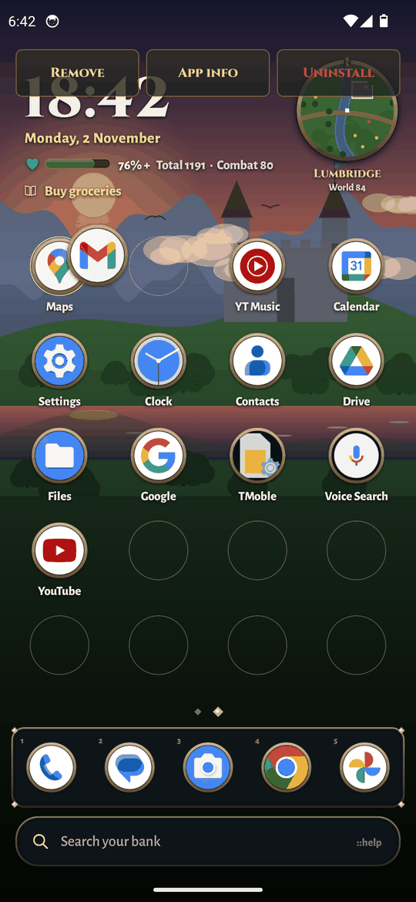
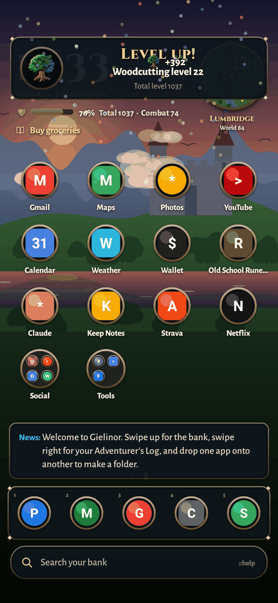

# RuneLauncher

An Android home screen with a RuneScape 3 coat of paint, tuned for the Pixel 7 Pro. It works like
the launcher you already know (app grid, folders, dock, swipe up for all apps) and looks like the
RS3 interface: dark glass, gold frames, Cinzel titles, the real skill icons, XP drops and level-ups.

  
  
  

  
  
  

## Install

1. On your phone, download **[RuneLauncher.apk](https://github.com/RamonG3/Misc./releases/download/runelauncher-latest/RuneLauncher.apk)**
   (GitHub Actions rebuilds it on every push).
2. Open it and allow installing from your browser if Android asks.
3. Press Home and pick **RuneLauncher**, or go to Settings → Apps → Default apps → Home app.

Updating from the Old School version keeps your stuff: your inventory becomes the home screen
(anything that doesn't fit goes into a **Backpack** folder), your equipment becomes the dock, and
your XP carries over.

## How it works

| Do this | Get this |
|---|---|
| Tap an app | Open it. |
| Swipe up anywhere, or tap the search bar | The bank: all apps, A to Z. Scrub the letter rail to jump. Search filters as you type; Enter opens the top match, or searches the web. |
| Hold an app | Options: remove, move to dock, put in a folder, examine, app info, uninstall. |
| Hold and drag an app | Move it around the grid or into the dock, or drop it on Remove / App info / Uninstall at the top. From the bank, drag an app out onto the home screen. |
| **Drop an app onto another app** | **They become a folder** (named after what they have in common). Drop onto a folder to add to it. |
| Tap a folder | Opens it. Tap the title to rename, **+** to add apps, hold an app for options, drag it out to move it back to the home screen. |
| Hold a folder | Open, rename, add apps, ungroup, remove. |
| Hold an empty spot | Add apps, settings, background, world hop, Android settings. |
| Swipe down | Notifications. |
| Swipe right | The Adventurer's Log (below). |
| Back or Home | Close whatever is open; Home again goes back to the home page. |

Up top: a clock (tap for alarms), the date (calendar), your **life points** (the battery; tap for
battery settings), total and combat level, and your next quest. The minimap opens your maps app;
hold it to hop worlds.

## The RS3 bits

- **Skills.** Every app trains one of the 29 skills. Social media trains Thieving, browsers train
  Runecrafting (slowly), backups train Necromancy. The real XP curve, 99 or 120 for the elite skills.
- **XP drops** float up next to the minimap, and **level ups** get a banner and fireworks.
- **Gielinor** is painted live behind your icons: the sky follows the real time of day, clouds drift,
  birds fly over a castle and a lake. It only animates while the home screen is showing and stops in
  battery saver. Prefer your own wallpaper? Settings → Background.
- **Interface themes:** Gielinor Gold, Necromancy, Ancient Steel, Dragonkin and Menaphos.
- **Icon styles:** Gilded (a gold rim, made for Pixel's round icons), stock, or Old School pixels.
- **Examine** any app to see which sensitive permissions it holds, with a "snooping level".
- **Achievements** for doing launcher things the first time.

## The Adventurer's Log

Swipe right from home:

| Card | What it does |
|---|---|
| Profile | Name, combat level, total level, quest points, total XP. |
| Skills | All 29. Tap one for its XP, the next level, and which of your apps train it. |
| Prayers | Quick settings: internet, flashlight, Bluetooth, Do Not Disturb, volume, location, battery saver, hotspot, airplane mode, settings. |
| Music player | Play, pause and skip whatever is playing. |
| Quest journal | A to-do list. Tap to complete a quest (and earn a quest point). Hold to rename or abandon. |
| Recently used | Your last five apps. |

Turn it off in Settings if you just want the home screen.

## Commands

Type these in the search: `::help`, `::stats`, `::name <name>`, `::theme <name>`, `::hop`,
`::wiki <query>`, `::ge <item>`, `::settings`, `::log`, `::reset`. `::dupe` does exactly what you'd expect.

## Building

Standard Android project, no third-party dependencies beyond the Kotlin standard library.
Open `RuneLauncher/` in Android Studio, or run `./gradlew assembleRelease`.

Builds are signed with `keystore/shared.jks`, a throwaway key committed on purpose so every CI
build installs over the previous one. It is fine for sideloading; don't use it for the Play Store.

CI also boots a Pixel 7 Pro emulator, runs the release build as the home app to check it survives
real swipes, then photographs every screen with the debug build (including a real drag that makes a
folder) and attaches the screenshots to the release. Debug builds take `--es demo <screen>` extras
(`seed`, `home`, `drawer`, `log`, `folder`, `settings`, `examine:N`, `menu:N`, `homemenu`,
`levelup`, `rename`, `theme:<id>`); release builds ignore them.

## Credits and disclaimer

A fan project, not affiliated with or endorsed by Jagex. RuneScape is a trademark of Jagex Ltd.
The skill icons in `app/src/main/assets/skills` are RuneScape artwork © Jagex, included for personal
use. Everything else (the scene, the interface, the glyphs) is drawn in code. Fonts:
[Cinzel](https://github.com/NDISCOVER/Cinzel) and [Alegreya Sans](https://github.com/huertatipografica/Alegreya-Sans),
both SIL OFL; licences in `app/src/main/assets/fonts`.
