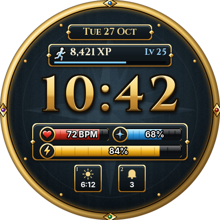
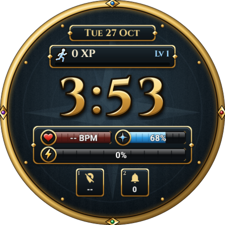
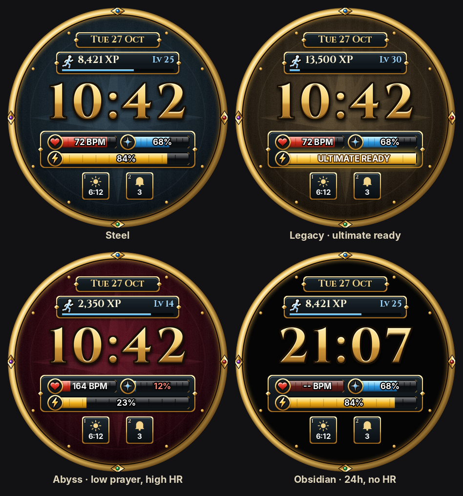

# RuneWatch

A RuneScape 3 watch face for Pixel Watch (and any Wear OS 4+ watch).
Your heart rate is your Life points, your battery is your Prayer, and every step you take is
Agility XP on the real experience curve. Level 99 needs 13,034,431 steps in one day.

<p>
  
  
</p>

*Left: the preview. Right: the real thing on the Wear OS 5 emulator in CI, where nobody
has walked anywhere or has a pulse, so it is a level 1 adventurer at "-- BPM".*

<p>
  
</p>

## What does what

| RuneScape | On your wrist |
|---|---|
| Gold numbers | The time. Follows your 12/24-hour setting. |
| Agility XP tracker | Today's steps, 1 step = 1 XP. The level and the progress bar use the real XP table, so 10,000 steps is level 27. It resets at midnight, which is more than the game ever did for you. |
| Life points | Heart rate. The bar drains as your heart rate goes up: resting is full health, sprinting is "eat something". Shows `--` until the watch has a reading. |
| Prayer | Battery. Turns red at 15%, which is your cue to find an altar (charger). |
| Adrenaline | Progress to your daily step goal. At 100% it glows and says ULTIMATE READY. |
| Action slots 1 and 2 | Complications. Long-press the face → Customize to put anything in them (weather, timer, next event...). Ranged values show as an ability cooldown ring. |
| Always-on | Hollow gold numbers and the date. Everything else switches off to save battery. |

### Customize

Long-press the watch face, then tap **Customize**:

* **Interface**: Steel (the default), Legacy (brown, like the old interface), Abyss (red),
  or Obsidian (plain black, kindest to your battery).
* **Action slot 1 / 2**: any complication. Defaults are sunrise/sunset and unread notifications.

## Install on a Pixel Watch

Watches have no browser, so the APK is sideloaded over Wi-Fi. It takes about five minutes, once.

**Get the APK:** [RuneWatch.apk](https://github.com/RamonG3/Misc./releases/download/runewatch-latest/RuneWatch.apk)
(GitHub Actions rebuilds it on every push).

**1. Turn on wireless debugging on the watch**

1. Settings → System → About → Versions. Tap **Build number** 7 times until it says you are a developer.
2. Back in Settings → **Developer options**: turn on **ADB debugging** and **Wireless debugging**.
3. Keep the watch on the same Wi-Fi network as your phone (or computer).

**2a. Install from an Android phone (no computer)**

1. Install an ADB app on the phone, for example *Bugjaeger* or *Wear Installer 2* from the Play Store.
2. Download `RuneWatch.apk` on the phone.
3. On the watch: Developer options → Wireless debugging → **Pair new device**. It shows a pairing
   code and an IP address with a port.
4. In the phone app, pair using that code and address, connect, then install `RuneWatch.apk`.

**2b. Or install from a computer**

```shell
adb pair 192.168.1.23:41235      # IP:port and code from "Pair new device"
adb connect 192.168.1.23:39787   # IP:port shown on the Wireless debugging screen
adb install RuneWatch.apk
```

**3. Pick it**

Long-press the current watch face, swipe to the end, tap **Add** (+) and choose **RuneWatch**.
The watch may ask to allow access to heart rate and activity; allow both or the bars stay empty.

When you are done, turn **Wireless debugging** back off. Updates install the same way, over the top.

## How it is built

It uses [Watch Face Format](https://developer.android.com/training/wearables/wff) v1: the whole
face is one XML file (`watchface/src/main/res/raw/watchface.xml`) plus images, no code. That is
what Pixel Watch requires for new watch faces, and it is easy on the battery.

| File | What it is |
|---|---|
| `watchface/src/main/res/raw/watchface.xml` | The watch face: layout, data sources, conditions, always-on mode. |
| `tools/generate_assets.py` | Draws every image: the gold digits, bezel, panels, bars, badges and backgrounds. |
| `tools/xp_expressions.py` | Builds the expressions that turn steps into an Agility level. WFF has no loops, so it is a tree of ternaries. |
| `tools/render_preview.py` | A small WFF renderer. Renders the screenshots and checks every expression, data source and image before anything reaches a watch. |
| `tools/ci_screenshot.sh` | Used by CI to screenshot the face on a Wear OS emulator. |

To change something:

```shell
pip install pillow numpy
python3 tools/generate_assets.py   # after changing the art
python3 tools/render_preview.py    # check + regenerate docs/*.png and the picker preview
./gradlew assembleRelease          # needs the Android SDK; CI does this for you
```

CI (`.github/workflows/runewatch.yml`) also validates the XML with Google's official
[WFF validator](https://github.com/google/watchface), builds the APK, and attaches an emulator
screenshot (`screenshot.png`) to the release.

Builds are signed with `keystore/shared.jks`, the same throwaway key as RuneLauncher, committed
on purpose so every CI build installs over the previous one. Fine for sideloading; not for the
Play Store.

## Credits and disclaimer

A fan project, not affiliated with or endorsed by Jagex. RuneScape is a trademark of Jagex Ltd.
No Jagex assets are included: every image is drawn in code by `tools/generate_assets.py`.
The numbers and labels use [Cinzel](https://github.com/NDISCOVER/Cinzel) (SIL Open Font
License, see `licenses/OFL-Cinzel.txt`).
